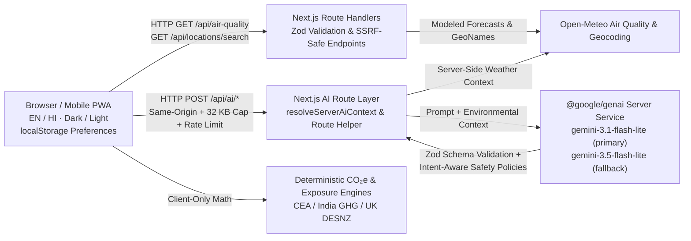

# VayuWise AI

**Breathe Smarter. Live Greener.**  
*PromptWars Virtual Challenge 6 — Urban Air Quality Assistant (Google for Developers & Hack2skill)*

- **Live Production App:** [https://vayuwise-ai-one.vercel.app/](https://vayuwise-ai-one.vercel.app/)
- **GitHub Repository:** [https://github.com/bhagya0007/vayuwise-ai](https://github.com/bhagya0007/vayuwise-ai)

---

## Challenge & Problem Statement

Urban households across winter-smog hotspots face severe particulate pollution episodes while needing practical daily routines that balance respiratory protection, indoor air hygiene, and sustainable low-emission habits. VayuWise AI converts modeled real-time air quality data and non-PII family preferences into actionable, health-first guidance, indoor protection checklists, community action plans, and verifiable commute emissions comparisons in English and Hindi.

---

## Core Features

- **Daily Overview & Air Quality Intelligence (`/dashboard`):** Live Open-Meteo / CAMS modeled `US AQI`, top 3 immediate recommendations, 4 primary quick actions (`Plan my day`, `Improve home air`, `Find green choices`, `Calculate my impact`), 24h/48h forecast chart, explicit **Forecast Lowest vs. Practical Daytime Window (07:00–20:00)**, global city search + geolocation, and expandable progressive disclosure accordions for detailed pollutants (`PM₂.₅`, `PM₁₀`, `NO₂`, `O₃`, `SO₂`, `CO`) and trends.
- **Ask Vayu AI & Daily Plan (`/assistant`, `/planner`):** Server-side Google Gemini (`@google/genai`) assistant producing direct 3–5 item answers with a viewport-pinned composer, mobile bottom-bar clearance, expandable `"Why this recommendation?"` explainability, intent-aware safety overrides, and a compact chronological `/planner` timeline.
- **Home Air, Green Choices & Community (`/indoor-air`, `/sustainability`, `/community`):**
  - Unmeasured-indoor disclosure, `"What you can do today"` checklist synced with activity tracking, top room tips + `"Things to avoid"`, and expandable room/cooking/budget controls.
  - Clear Before -> After sustainable habit swaps with `"Estimated benefit"`, `"Calculate Impact →"` links, and expandable `"Trade-offs & Methodology"`.
  - Concise **Today**, **This Week**, and **This Month** community smog plans with expandable stakeholder checklists, Copy, Share, and Print actions.
- **Your Environmental Impact (`/impact`):** Audited 12-mode transport CO₂e calculator (`CEA India v20.0`, `India GHG Program v1.0`, `UK DESNZ 2024`) with a clean 2-tab layout (`Travel CO₂e Impact` vs. `Outdoor Exposure Comparison`), 4 essential inputs upfront + collapsible `Advanced Settings`, expandable `How We Calculate This`, duplicate-guarded Activity Tracker, and Gemini explanations restricted strictly to deterministic numbers.
- **Personalization, Bilingual EN/HI, Printable Report & Lightweight PWA (`/onboarding`, `/profile`, `/report`, `/settings`):** Clean consumer sidebar (`TODAY`, `TAKE ACTION`, `ACCOUNT & TOOLS`) and 5-tab mobile bottom bar (`Home`, `Plan`, `AI`, `Impact`, `More`), optional 6-step onboarding, `Advanced Preferences` accordion on Profile, full EN/HI UI, A4 printable report (`@media print` with respiratory sensitivity excluded by default), static-only Service Worker (`public/sw.js`), and `Delete All Local Data`.

---

## Technical Architecture



### Technology Stack
- **Framework:** Next.js `16.4.6` (App Router, Turbopack), React, TypeScript (`strict: true`)
- **Styling & UI:** Tailwind CSS v4 tokens, shadcn/ui primitives, Lucide icons, Motion, Recharts
- **GenAI & Validation:** `@google/genai`, Zod schemas, server-only runtime configuration (`src/config/env.ts`)
- **Testing:** Vitest + Testing Library (unit & AI safety evaluation) and Playwright Chromium (E2E & responsive checks)

---

## Genuine GenAI Integration & Safety Design

- Every `/api/ai/*` endpoint runs strictly server-side using `GEMINI_API_KEY`, defaulting to `gemini-3.1-flash-lite` with bounded concurrency (`4`), `18s` timeout, automatic Flash-Lite resilience fallback (`gemini-3.5-flash-lite`), `1` schema corrective retry, and explicit rule-based fallback on unavailability.
- System prompts wrap user messages in `<untrusted_user_input>` delimiters, cite only verified registry IDs (`WHO_AQG_2021`, `US_EPA_AQI`, `US_EPA_INDOOR`, `MOHFW_INDIA`, `NCDC_INDIA`, `OPEN_METEO_AQ`, `CEA_INDIA_CO2_V20`, `INDIA_GHG_TRANSPORT`, `UK_DESNZ_GHG_2024`), and distinguish **Gemini**, **Gemini (Safety Adjusted)**, and **Rule-Based Fallback**.

---

## Data Sources & Environmental Calculation Methodology

- **Air Quality:** Open-Meteo Air Quality API / Copernicus CAMS modeled `US AQI` and hourly pollutant concentrations (`µg/m³`). Explicitly labeled as modeled regional estimates — never official Indian CPCB NAQI ground-station data.
- **Transport Emission Factors (`EMISSION_FACTOR_REGISTRY_VERSION = "2026.11-audit-v5"`):**
  - *CEA CO₂ Baseline Database v20.0 (FY 2023-24):* India weighted grid factor `0.727 kg CO₂/kWh`.
  - *India GHG Program v1.0:* CNG Car `0.068 kg CO₂/vkm`, Petrol Two-Wheeler `0.0387 kg CO₂/vkm`, Intracity Bus `0.015161 kg CO₂/pkm`.
  - *UK DESNZ 2024:* Reference Petrol Car `0.163 kg CO₂e/vkm`, Diesel Car `0.170 kg CO₂e/vkm`.
  - *Accounting Boundaries:* Explicit separation of `vehicle_km` (`Distance × Factor ÷ Occupancy`), `passenger_km` (`Distance × Factor`), `CO2` vs. `CO2e`, `tailpipe_ttw` vs. `electricity_generation_scope2`, and ambient outdoor `PM₂.₅ × duration` (`µg·h/m³`, not inhaled dose or clinical risk).

---

## Local Setup & Environment Variables

1. Install dependencies:
   ```bash
   npm install
   ```
2. Copy `.env.example` to `.env.local` and configure:
   - `GEMINI_API_KEY`: Server-side Google AI Studio API key (never commit `.env.local`).
   - `GEMINI_MODEL`: Primary Gemini model (recommended: `gemini-3.1-flash-lite`).
   - `GEMINI_AI_ENABLED`: `true` or `false` kill-switch for AI routes.
   - `AI_RATE_LIMIT_PER_MIN`: Per-IP sliding-window limit per route bucket per Node isolate (default: `15`).
   - `NEXT_PUBLIC_APP_NAME` / `NEXT_PUBLIC_APP_URL`: Public app metadata.
3. Run locally or test production build:
   ```bash
   npm run dev     # Development server on http://localhost:3000
   npm run build   # Production build
   npm run start   # Production server
   ```

---

## Testing & Verification Commands

- `npm run typecheck` — Strict TypeScript check (`tsc --noEmit`)
- `npm run lint` — ESLint check across app, components, API routes, and tests (`0` errors, `0` warnings)
- `npm run test` — Run all Vitest unit, API route integration, Gemini/Open-Meteo service resilience, impact math, and AI safety tests (`104` tests across `14` files; `92.64%` statement and `75.09%` branch coverage on `src/app/api`, `src/config`, `src/lib`, `src/services`)
- `npm run test:e2e` — Run all Playwright Chromium E2E tests (`32` tests across `9` files, including `@axe-core/playwright` WCAG 2.2 AA & HTTP security header checks)
- `npm audit --omit=dev` — Verify production dependencies (`0` vulnerabilities)

---

## Security, Privacy & Known Limitations

- **Zero Client Key Leakage & Strict Security Headers:** `GEMINI_API_KEY` is read exclusively inside `src/config/env.ts` server helpers and verified absent from `.next/static`. `next.config.ts` disables `X-Powered-By` (`poweredByHeader: false`) and configures `Content-Security-Policy`, `Strict-Transport-Security`, `X-Frame-Options: DENY`, `X-Content-Type-Options: nosniff`, `Referrer-Policy: strict-origin-when-cross-origin`, and `Permissions-Policy`.
- **Google Gemini Free-Tier Disclosure:** Under Google's unpaid/free-tier Gemini API terms, prompts and outputs sent to the API may be logged or reviewed by Google to improve products/ML models. Users are explicitly cautioned not to enter medical records, personal identities, or confidential details.
- **PWA Cache Privacy:** `public/sw.js` caches only immutable static `/_next/static/*` assets and `.svg` icons, strictly bypassing `/api/*` and browser preferences.
- **Known Limitations:**
  - In serverless multi-instance deployments (e.g., Vercel), the built-in per-route (`15` req/min) and aggregate (`23`–`30` req/min) sliding-window limiters operate per Node.js isolate rather than globally across concurrent instances.
  - Regional CAMS/Open-Meteo forecasts do not measure household indoor air or hyperlocal street-level traffic spikes.

---

## Deployment Instructions (Vercel / Node.js)

1. Push the repository to GitHub (verifying `.env.local` is excluded).
2. Import the repository into Vercel (`Node >= 20`, Framework Preset: `Next.js`).
3. Set Environment Variables in Vercel Project Settings:
   - `GEMINI_API_KEY` = *your private Google AI Studio key (server-only)*
   - `GEMINI_MODEL` = `gemini-3.1-flash-lite`
   - `GEMINI_AI_ENABLED` = `true`
   - `AI_RATE_LIMIT_PER_MIN` = `15`
   - `NEXT_PUBLIC_APP_URL` = *your Vercel production URL (optional — automatically falls back to `VERCEL_PROJECT_PRODUCTION_URL` / `VERCEL_URL`)*
4. **Configure Vercel Firewall Rate Limiting (Hobby & Pro Plans Supported):**
   - Open Vercel Dashboard -> **Firewall** -> **Configure** -> **+ New Rule**.
   - **Condition:** `Request Path` -> `Starts With` -> `/api/ai/` (optional second condition: `Request Method` = `POST`).
   - **Action:** `Rate Limit` -> Strategy: `Fixed Window`, Window: `60s`, Limit: e.g. `15–20` requests per IP.
   - Click **Save Rule** and **Publish**. *(Vercel's free Hobby plan includes 1 custom rate-limiting rule per project and 1,000,000 monthly allowed requests; Pro increases rule limits. For multi-region stateful quotas, wire free-tier Upstash Redis.)*

---

## License, Privacy & Third-Party Attributions

- **Privacy:** Local browser preferences (`localStorage`) stay client-side; non-PII AI prompts do not persist in a VayuWise database. See Settings & `/report` for clear disclaimers and Google Gemini free-tier policy links.
- **Third-Party Data:** Modeled air quality & geocoding via [Open-Meteo](https://open-meteo.com/) & GeoNames; public health advisories from WHO, US EPA, India MoHFW / NCDC; transport emission factors from CEA India (`v20.0`), India GHG Program (`v1.0`), and UK DESNZ (`2024`).
- **Project Source License:** MIT / Challenge Submission Repository.
- **Technical Docs:** [System Architecture](docs/ARCHITECTURE.md) · [Project Roadmap](docs/PROJECT_ROADMAP.md) · [Phase Verification Report](docs/PHASE_REPORT.md)
